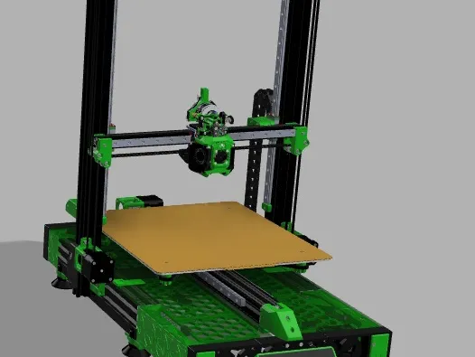

# Enderwire 300

### An Ender 3 Max Neo conversion by Captain Kearn

Enderwire 300 adapts a Creality Ender 3 Max Neo into an Enderwire-style CoreXZ printer. It combines parts from **Trinity Nova Max Neo V1**, ideas and construction references from **Ender_SW**, and a **Dragon Burner** toolhead with Mellow electronics and an ALPS Ultra HF hotend.

The aim is to document the work needed to make these projects fit the larger Max Neo, including the details that are easy to miss when building from model files alone.

*Reference render: Jackmiller's Trinity Nova Max Neo V1, extracted unchanged from its supplied Printables PDF; CC BY-SA 4.0. This depicts the source design and its toolhead, not Captain Kearn's finished Dragon Burner build. [Source and image credits](docs/09-sources-and-credits.md).*

## Documentation status

**Draft v0.1 - October 31, 2026.** This is a build-documentation foundation, not a released, independently replicated build recipe. The assembly sequence is proposed; exact rail lengths, fastener counts, adapted CAD, belt routing photographs, and the final wiring/configuration remain to be recorded from the physical build.

The name **300** identifies this project. It is not a guarantee of 300 mm travel on every axis. Final printable travel must be measured after conversion.

## Build specification

| Component | Project specification | Evidence/status |
| --- | --- | --- |
| Donor printer | Creality Ender 3 Max Neo | Confirmed by builder |
| Motion | Enderwire/Switchwire-style CoreXZ; independent moving Y bed | Design basis; final belt routing to document |
| Mainboard | Mellow FLY-C5 | Confirmed by builder |
| Toolhead | Dragon Burner | Confirmed by builder; revision and carriage adapter pending |
| Hotend | ALPS Ultra HF | Builder's description; exact Mellow SKU, heater and sensor pending |
| Motors | Stock Ender motors reused | Confirmed by builder; individual motor roles and ratings pending |
| Toolhead electronics | Mellow toolhead board | Model/revision to confirm; earlier project context mentions SHT36 V3 |
| Firmware | Klipper documentation path | Final working configuration pending |
| Extruder, probe, homing | Record the installed choices | Not established by this specification |

## Build guide

Read these in order:

1. [Planning, tools, and donor preparation](docs/01-planning.md)
2. [Bill of materials and printed parts](docs/02-parts.md)
3. [Frame, rails, and Y bed](docs/03-frame-and-y.md)
4. [CoreXZ gantry, belts, and counterbalance](docs/04-corexz.md)
5. [Dragon Burner and ALPS hotend](docs/05-toolhead.md)
6. [Mellow electronics and wiring](docs/06-electronics.md)
7. [Klipper and first commissioning](docs/07-klipper.md)
8. [Troubleshooting and maintenance](docs/08-troubleshooting.md)
9. [Sources, attribution, and licensing](docs/09-sources-and-credits.md)
10. [Photo replacement guide](docs/10-photos.md)
11. [Build record and remaining measurements](docs/11-build-record.md)

The [parts inventory](bom/trinity-file-inventory.csv) lists the actual local Trinity STL filenames. It is an inventory, not a verified shopping list or an instruction to print every file.

## How this differs from the source projects

| Source | What this project uses | What must change or be checked |
| --- | --- | --- |
| Trinity Nova Max Neo V1 | Max Neo-oriented conversion parts | Which parts were actually installed; final dimensions and hardware |
| Ender_SW by boubounokefalos / DaRk_dOg | Conversion approach and assembly references | Smaller Pro/V2 dimensions must not be transferred directly |
| Dragon Burner by chirpy2605 | Toolhead design | Switchwire carriage interface, hotend mount, extruder and board mount |
| FizzysTech FT Enderwire | Additional lineage identified in Trinity's PDF | EMS mount selection and any parts actually reused |
| Voron Design | Switchwire/CoreXZ reference | Adaptation to the Max Neo donor and chosen electronics |

Do not resize an entire STL by a percentage to fit the larger printer: that also changes screw holes, rail interfaces, and bearing fits. Adapt dimensional features in CAD while preserving hardware interfaces.

## Photos and contributions

Reference images are included locally, with captions and credits. Add your own photographs under `docs/images/build/` and follow [the replacement checklist](docs/10-photos.md). Contributions should identify the donor, hardware revisions, file origins, and measurements. See [CONTRIBUTING.md](CONTRIBUTING.md).

## Before powering up

Work with power disconnected during assembly and wiring. Support the gantry whenever belts or motors cannot hold it. Verify grounding, supply polarity, protection, and all temperature readings before enabling heat or homing. Use the commissioning gates in the guide; an example upstream configuration is not a tested configuration for this build.

## Credits

Thanks to Jackmiller, boubounokefalos / DaRk_dOg, FizzysTech, Triano, chirpy2605, MapleLeafMakers, Voron Design, Mellow, and Klipper contributors. Enderwire 300 is an independent community build. See [NOTICE.md](NOTICE.md) for asset and license boundaries.
