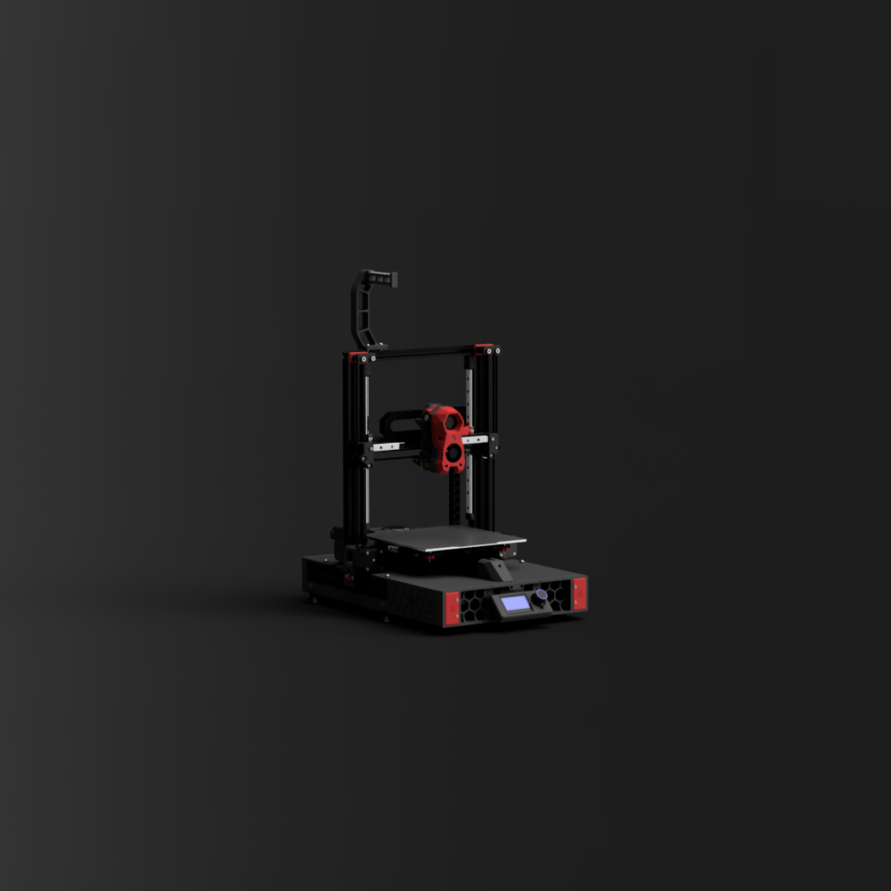

# 3. Frame, rails, and Y bed

[Previous](02-parts.md) | [Guide index](../README.md) | [Next](04-corexz.md)

## Reference overview

*Unmodified Ender_SW `1.png`, boubounokefalos / DaRk_dOg, GPL-3.0; [source](https://github.com/boubounokefalos/Ender_SW/blob/f5556ba3f83db3e15cfd411859f369d85cbd6634/1.png). This smaller Pro/V2 design illustrates the conversion layout, not Max Neo dimensions or the Enderwire 300 toolhead.*

## Square the base and uprights

1. Set the bare frame on a stable flat surface. Remove debris from extrusion mating faces.
2. Loosen only the joints needed to align it. Square the uprights to the base and check parallelism.
3. Compare base diagonals using consistent reference points, then tighten gradually and recheck.
4. Dry-fit the selected front/rear extensions. Check their fastener engagement and clearance to bed motion.
5. Leave decorative skirts and deck panels off until the mechanisms and wiring are inspected.

Extensions and printed skirts are not lifting handles. Lift by the structural frame.

## Fit and align the Y guides

Trinity's Y files identify an MGN12H bed-carrier interface. Confirm the chosen rail layout in CAD and on the physical base before drilling or fastening. Do not inherit the smaller Ender_SW rail lengths.

1. Clean and lubricate rails according to the rail supplier. Keep carriages on their rails and use end stops.
2. Establish a straight reference rail against a consistent frame datum. Tighten gradually without pulling a distorted rail into place.
3. For a dual-rail layout, loosely fit the second rail and carrier. Move the unloaded carrier through the intended stroke, tightening progressively while checking for binding.
4. Check carriage engagement, rail-end clearance and fastener protrusion at both extremes.
5. If drag changes with position, resolve rail alignment and carrier distortion before attaching belts or increasing motor current.

## Install the bed carrier, motor and idler

1. Dry-fit the selected `Y Gantry` parts and confirm which long/short bed supports match the actual assembly.
2. Mount the Y motor using verified screw lengths; screws must not bottom in its case.
3. Fit the pulley and idler hardware specified by the selected CAD. Align the pulley and idler to the belt-clamp plane.
4. Route the Y belt without twist. Leave adjustment available at the tensioner and enough tail for the clamps.
5. Attach the donor bed without distorting the carrier. Inspect heater insulation and sensor retention.
6. Add bed-cable strain relief so the heater/sensor joints never carry the repeated bending load.

## Prove the complete movement envelope

Move the bed slowly by hand through its full proposed range with power disconnected. Check the rear cable loop, base, skirts, vertical frame, tensioner and future toolhead clearance. Fit panels temporarily to identify interference. Measure usable nozzle-to-bed coverage later; bed dimensions alone do not establish printable travel.

**Gate:** smooth Y motion, no rail binding, belt centered, bed cable relaxed at both extremes, and no collision with the frame or panels.

**Photos to add:** `P03` rail alignment, `P04` bed underside and `P05` Y pulley/idler/belt clamps.
