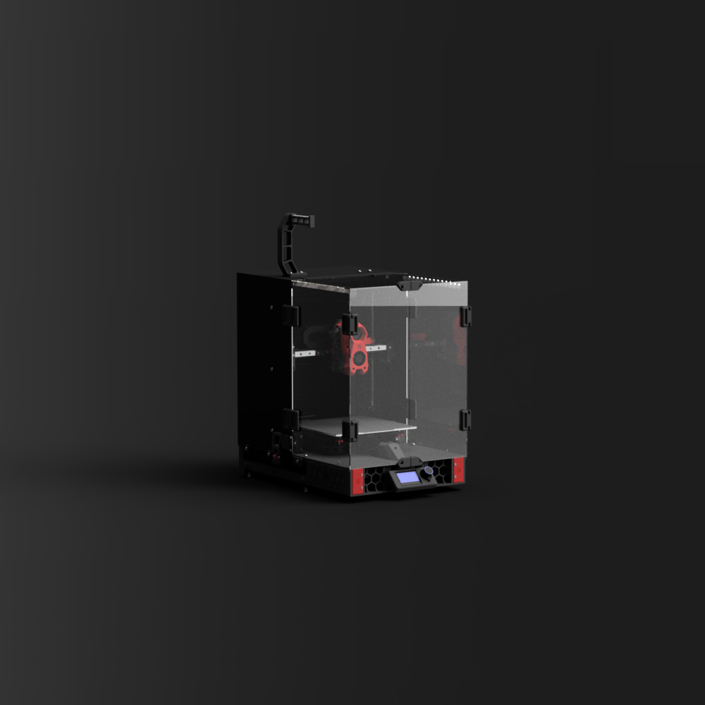

# 10. Replace reference images with build photos

[Guide index](../README.md)

Keep upstream images in `images/reference/`; add original photographs under `images/build/`. Use lowercase, descriptive filenames without spaces. Replace a reference image's Markdown path and its caption together so the new photograph is credited accurately.

For example, replace the README image with `docs/images/build/finished-front.jpg` and caption it as Captain Kearn's actual Enderwire 300, including the build revision. Retain source credits elsewhere for upstream assets still distributed.

## Photo checklist

| ID | Suggested filename | What the image needs to show | Guide |
| --- | --- | --- | --- |
| P00 | `finished-front.jpg` | Whole completed printer, front three-quarter view | README |
| P01 | `donor-overview.jpg` | Ender 3 Max Neo before disassembly | 01 |
| P02 | `bare-frame.jpg` | Base, uprights and measurement reference points | 01 |
| P03 | `y-rails.jpg` | Rail mounting/alignment and overall lengths | 03 |
| P04 | `bed-underside.jpg` | Carrier, supports, heater/sensor and strain relief | 03 |
| P05 | `y-drive.jpg` | Motor pulley, idler, belt clamps and tensioner | 03 |
| P06 | `corexz-belt-routing.jpg` | Both complete belt paths; use multiple images if necessary | 04 |
| P07 | `corexz-idler-stacks.jpg` | Motor mounts and exploded or accessible spacer stacks | 04 |
| P08 | `counterbalance.jpg` | Attachment and cable reach at both Z extremes | 04 |
| P09 | `dragon-burner-front-side.jpg` | Nozzle, duct position and probe clearance | 05 |
| P10 | `toolhead-rear.jpg` | Carriage adapter, board mount and cable retention | 05 |
| P11 | `component-labels.jpg` | Motor, heater, sensor and fan identification | 05 |
| P12 | `fly-c5-wiring.jpg` | C5 revision, drivers, jumpers and readable connector labels | 06 |
| P13 | `toolhead-board-wiring.jpg` | PCB revision and connector orientation | 06 |
| P14 | `bed-wiring.jpg` | Separate heater/sensor paths and wire protection | 06 |
| P15 | `first-layer.jpg` | First layer with temperature, material and settings recorded | 07 |

Use multiple close-ups when one image cannot show the relevant detail. Photograph wiring only with power disconnected. Add a ruler for dimensional details; do not infer dimensions from perspective. Avoid passwords and private identifiers in photos.

## Gallery reference

*Unmodified Ender_SW `2.png`, boubounokefalos / DaRk_dOg, GPL-3.0. This is a second upstream design reference, not an Enderwire 300 build photograph. [Source](https://github.com/boubounokefalos/Ender_SW/blob/f5556ba3f83db3e15cfd411859f369d85cbd6634/2.png).*
